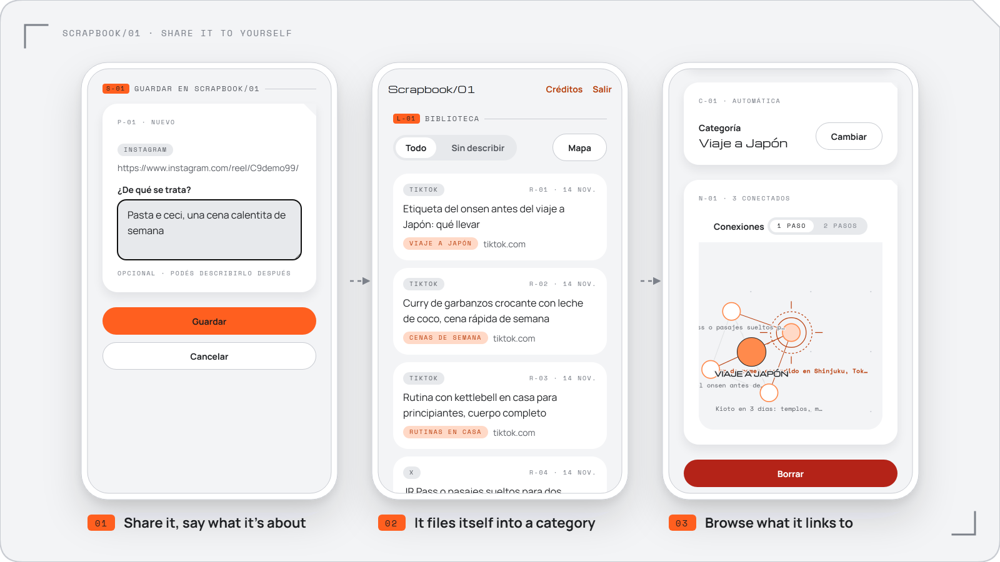
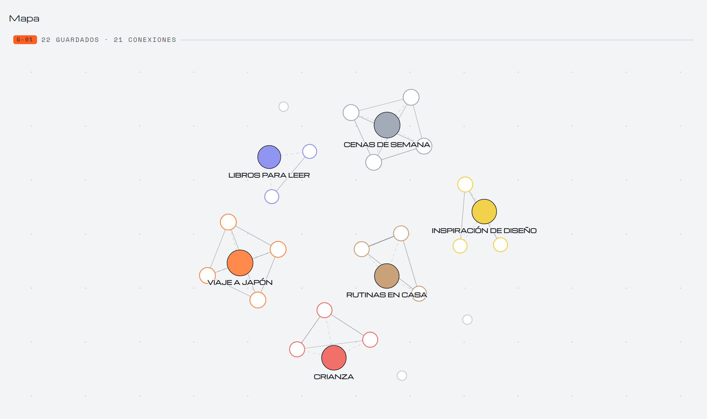
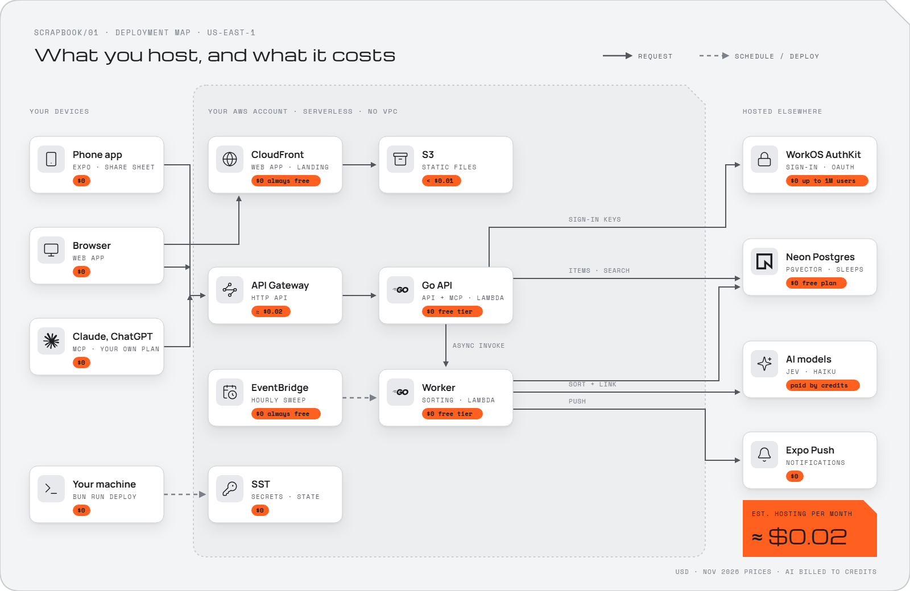

  

<h1 align="center">Scrapbook/01</h1>

  <b>Share things to yourself, and find them again.</b> 
  Save reels, TikToks, videos and links from any app with one line about what they are. 
  They sort themselves into categories and link up into a graph you can browse.

  
  
  
  
  

  

The app and the website are in Uruguayan Spanish; the code and these docs are in English.

## Contents

- [Why Scrapbook/01](#why-scrapbook01)
- [Share it, say what it's about](#share-it-say-what-its-about)
- [It sorts itself, for a fraction of a cent](#it-sorts-itself-for-a-fraction-of-a-cent)
- [A graph of everything you saved](#a-graph-of-everything-you-saved)
- [Ask your own AI about it](#ask-your-own-ai-about-it)
- [Up and running in five minutes](#up-and-running-in-five-minutes)
- [Serverless, so it costs cents](#serverless-so-it-costs-cents)
- [Status](#status)
- [Contributing](#contributing)
- [Security and license](#security-and-license)

## Why Scrapbook/01

<table>
  <tr>
    <td width="50%" valign="top">
      <b>Better than messaging yourself</b> 
      Share from Instagram, TikTok, YouTube or X straight into your library, instead of a chat with
      yourself where things sink. <a href="docs/features.md">Features →</a>
    </td>
    <td width="50%" valign="top">
      <b>Your words, not a scraper</b> 
      You type one line about what it is. Nothing is scraped and nothing is guessed from the link,
      so it works for every app and stays accurate. <a href="docs/features.md#saving">Saving →</a>
    </td>
  </tr>
  <tr>
    <td valign="top">
      <b>Files itself</b> 
      A small classifier picks one of your categories. Only when nothing fits does Claude Haiku name a
      new one. <a href="docs/sorting.md">How sorting works →</a>
    </td>
    <td valign="top">
      <b>Browse it like Obsidian</b> 
      Similar saves link up. Open any item to see its neighbors, and hop from one to the next.
      <a href="docs/features.md#the-graph">The graph →</a>
    </td>
  </tr>
  <tr>
    <td valign="top">
      <b>Your AI, your tokens</b> 
      Connect Claude or ChatGPT over MCP. Their reasoning runs on your own plan; the server only does
      cheap retrieval. <a href="docs/ai-assistants.md">AI assistants →</a>
    </td>
    <td valign="top">
      <b>Costs cents to host</b> 
      Two Go Lambdas, static sites on CloudFront and Postgres on Neon, all scaling to zero.
      <a href="docs/architecture.md#what-it-costs">Costs →</a>
    </td>
  </tr>
</table>

## Share it, say what it's about

Tap Share in any app and pick Scrapbook/01. A small sheet opens on top of the app you're in, with the
link filled in and the keyboard up on one question: "¿De qué se trata?" (what is it about?). Type a few words (or dictate
them) and tap Save. Skipping is fine too: undescribed saves wait in an inbox.

**[Read more: the features tour →](docs/features.md)**

## It sorts itself, for a fraction of a cent

Each description goes to [Jev](https://typesafe.ai), which picks one of your existing categories,
described by what you already put in them. Only when nothing fits does Claude Haiku name a new
category, in the language you wrote in. A notification says where it went, and you can move it.
Sorting a save costs about $0.000014; naming a new category about $0.0002.

**[Read more: how saves get sorted →](docs/sorting.md)**

## A graph of everything you saved

Every save is embedded once and linked to its closest neighbors with pgvector. The graph view draws
your whole library, with category hubs in Module/01's colors and similar saves linked. Each item shows
its connections one or two hops out; tap one to move there while the layout stays put.

  

**[Read more: the graph →](docs/features.md#the-graph)**

## Ask your own AI about it

Scrapbook/01 is an MCP server. Add it to Claude or ChatGPT as a connector, sign in, and ask "what was
that ramen place in Tokyo I saved?". It can search your library, open items and their neighbors, and
save new links. Your assistant's reasoning is billed to your own plan, not to Scrapbook/01.

**[Read more: AI assistants →](docs/ai-assistants.md)**

## Up and running in five minutes

You need Go, Bun and Docker, plus a free [WorkOS](https://workos.com) sandbox for sign-in. Postgres
runs in Docker, and a fake AI server stands in for Jev, the embeddings API and Claude, so the whole
save, sort and link flow works without any AI keys.

**[Read more: getting started →](docs/getting-started.md)**

## Serverless, so it costs cents

On AWS the API and the sorting worker are Go Lambdas behind API Gateway, the web app and landing page
are static sites on CloudFront, and Postgres runs on Neon, which scales to zero. With nobody using it,
nothing is billed. One person's month comes to about two cents of hosting; the AI calls are paid from
prepaid credits.

  

**[Read more: architecture and costs →](docs/architecture.md)** ·
**[Host it yourself →](docs/self-hosting.md)**

## Status

Early, and built in the open. The Go API, the MCP server, sorting, credits and the web app are tested
and run locally. Not yet proven on real hardware or accounts: the iOS share extension and push
notifications on a device, a first AWS deploy, and payments for credit packs (packs can be granted by
hand for now). Issues and pull requests are welcome.

## Contributing

Bug reports, fixes and ideas are all welcome. The app is Expo (React Native) styled with the
[Module/01](https://github.com/franco-roura/module-01) design system; the API is Go with sqlc and
River.

**[Read more: CONTRIBUTING.md →](CONTRIBUTING.md)** · **[Local development →](docs/development.md)**

## Security and license

Report security issues privately as described in [SECURITY.md](SECURITY.md).

Dual-licensed under either of [MIT](LICENSE-MIT) or [Apache-2.0](LICENSE-APACHE), at your option.
