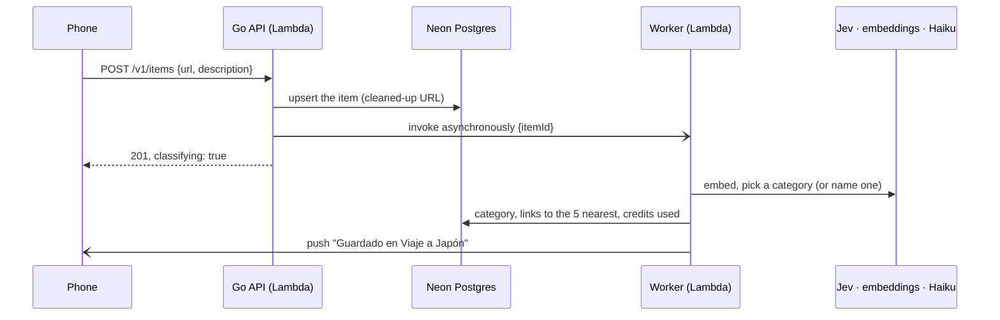

[← README](../README.md) · [Features](features.md) · [Getting started](getting-started.md) · [Sorting](sorting.md) · [AI assistants](ai-assistants.md) · [Self-hosting](self-hosting.md) · **Architecture** · [Development](development.md)

# Architecture and costs

What you host, how a save moves through it, and what it costs each month.

**On this page:** [The deployment map](#the-deployment-map) · [What it costs](#what-it-costs) ·
[How a save flows](#how-a-save-flows) · [One handler, two homes](#one-handler-two-homes) ·
[Background work](#background-work) · [The stack](#the-stack) · [Design rules](#design-rules)

## The deployment map

Everything in the AWS box is serverless: nothing runs, and nothing is billed, while nobody uses the
app. There's no VPC, so no NAT gateway. [`sst.config.ts`](../sst.config.ts) defines all of it, and
[`scripts/docs/architecture.ts`](../scripts/docs/architecture.ts) draws this map.

## What it costs

Estimated with **`us-east-1`** list prices from **November 2026**, for one active person: about 20,000 API
requests and 1,000 saves a month, a 50 MB database, and the hourly sweep. The stack deploys to
`sa-east-1` (São Paulo), where per-request prices are somewhat higher; at this scale the total is still cents.

| Service | What it does | Free tier | Monthly cost |
| --- | --- | --- | --- |
| Lambda (API, worker) | Runs all the Go code | 1M requests and 400,000 GB-s, **always free** | $0 |
| API Gateway (HTTP API) | Front door to the API and MCP | 1M requests, first 12 months on older accounts | ≈ $0.02 ($1 per million) |
| CloudFront | Serves the web app and landing page | 1 TB and 10M requests, **always free** | $0 |
| S3 | Static files, SST state and secrets | 5 GB, first 12 months | < $0.01 |
| S3 + CloudFront (Previews) | Copies of link preview pictures, about 50 KB each | Same free tiers as above | < $0.01 |
| EventBridge Scheduler | Hourly sweep | 14M invocations, **always free** | $0 |
| CloudWatch Logs | Function logs, kept a week | 5 GB, **always free** | $0 |
| Neon Postgres | The database, pgvector | Free plan: 100 CU-hours, 1 GB per project | $0 |
| WorkOS AuthKit | Sign-in, MCP OAuth | Up to 1M monthly active users | $0 |
| Expo Push | Notifications | Free | $0 |
| **Total hosting** | | | **≈ $0.02** |

AI calls aren't hosting: they're paid from the users' credits, about **$0.014 per thousand saves**
(see [How saves get sorted](sorting.md#what-it-costs)). Someone hosting it only for themselves pays
the AI providers directly, at that rate.

At **ten times the usage** hosting stays under $0.25 a month: API Gateway is the only line that grows.
The thing to watch is Neon's compute: each query wakes it for five minutes, so anything polling it all
day would use up the free 100 CU-hours. That's why the sweep runs hourly, not every minute. A
VPC with a NAT gateway (about $32 a month) is deliberately absent.

> [!NOTE]
> These are estimates from AWS's, Neon's and WorkOS's published prices, not a quote. Check the
> [AWS pricing calculator](https://calculator.aws/) and [Neon's pricing](https://neon.com/pricing) for
> your region. The app is served on its generated AWS addresses; a custom domain would add Route 53
> and certificate costs.

## How a save flows

- The app talks to the API directly; only the web app's files come from CloudFront.
- Every request carries a WorkOS access token. The API checks it against WorkOS's published keys, with
  no call to WorkOS per request.
- MCP is the same API, at `/mcp`: stateless Streamable HTTP with JSON responses, which API Gateway
  handles like any request.

## One handler, two homes

The API is one `http.Handler`, wired in [`server/internal/app`](../server/internal/app):

| Where | Entry point | Background work |
| --- | --- | --- |
| Your machine | `server/cmd/api`: a plain `net/http` server | [River](https://riverqueue.com), a job queue in the same Postgres, in the same process |
| AWS | `server/cmd/lambda-api`, wrapped by an API Gateway v2 adapter | `server/cmd/lambda-worker`, invoked asynchronously |

Both queue work through one interface (`EnqueueClassify`), and sorting is idempotent: it skips items
that are already sorted. So the local setup needs nothing from AWS, and the AWS setup needs no queue
service.

## Background work

- **Sorting** runs once per new description. On AWS, Lambda queues the async invoke and retries it
  twice on failure.
- **The sweep** (`ItemsNeedingClassification`) catches whatever was missed: a failed invoke, failed
  retries, or saves that waited for a credit top-up. Every minute locally, hourly on AWS, up to 50
  items per run.
- **Migrations** (`server/cmd/migrate`, [goose](https://github.com/pressly/goose) plus River's tables)
  run before each deploy, from your machine, against Neon's direct host. The Lambdas never migrate.

## The stack

| Layer | Tech |
| --- | --- |
| App | Expo (React Native) with expo-router, [Uniwind](https://uniwind.dev) (Tailwind v4), a native rebuild of the [Module/01](https://github.com/franco-roura/module-01) design system, Expo DOM components for the graph |
| Share | `expo-share-extension` (iOS), `expo-share-intent` (Android) |
| Graph | `react-force-graph-2d`, colors from Module/01's `tokens.json` |
| API | Go, `net/http`, the official MCP Go SDK, `golang-jwt` with JWKS |
| Data | PostgreSQL with pgvector, `sqlc` + `pgx/v5`, `goose` migrations, River for local jobs |
| AI | Jev (TypeSafe), OpenAI-compatible embeddings, Claude Haiku (`anthropic-sdk-go`) |
| Sign-in | WorkOS AuthKit (Magic Auth codes, OAuth 2.1 for MCP) |
| Hosting | AWS Lambda + API Gateway, S3 + CloudFront, EventBridge Scheduler, via SST; Postgres on Neon |

## Design rules

These hold everywhere in the code, and they're why the numbers add up:

- **The user describes; sorting never reads the post.** Sorting works from one human line, which keeps
  it accurate and its AI input tiny. The worker fetches a link's public preview (Open Graph or oEmbed)
  once, only to show it on the card, and copies its picture to the Previews bucket.
- **The cheapest model that can answer does.** Jev picks among existing categories; Claude only names
  new ones; embeddings are computed once per description.
- **Your AI reasons on your plan.** The MCP server only does retrieval, so there are no AI tokens to
  resell.
- **Every row belongs to a user**, and every query filters by the user from the token, never from the
  request.
- **The API is Lambda-safe:** stateless, configured only from environment variables, with background
  work behind one interface that River or a Lambda invoke can serve.

---

[← Self-hosting](self-hosting.md) · Next: [Development →](development.md)
