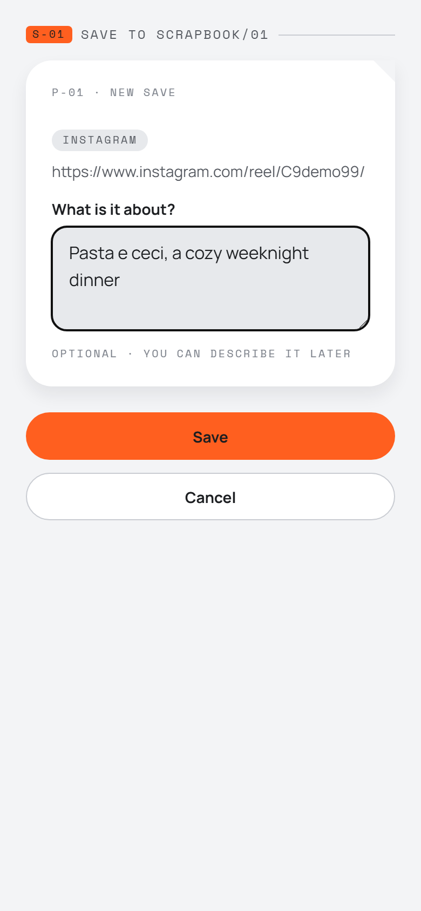
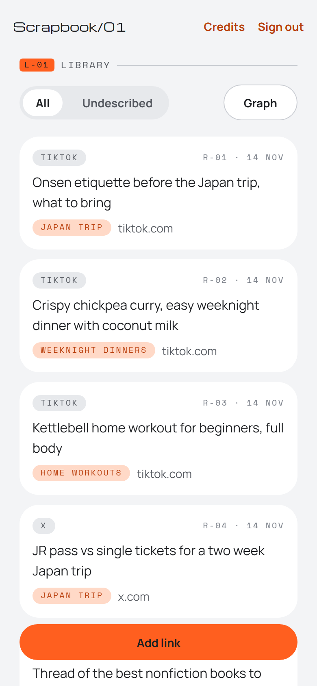
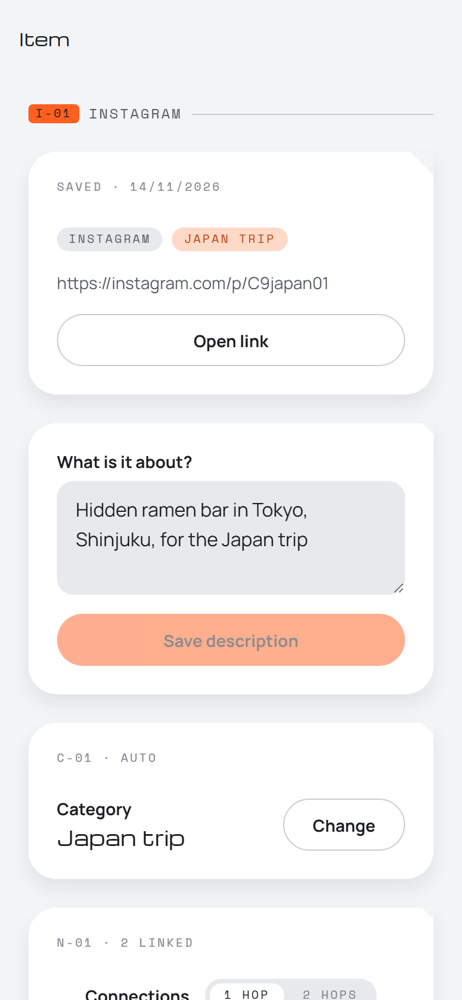
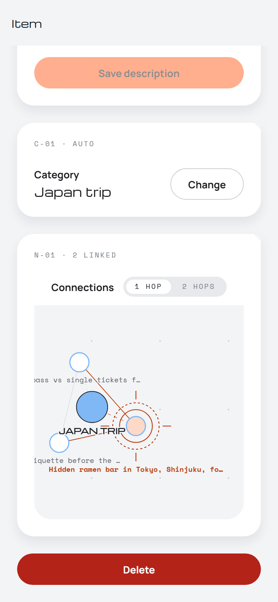
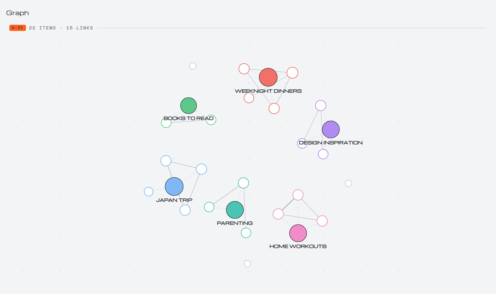
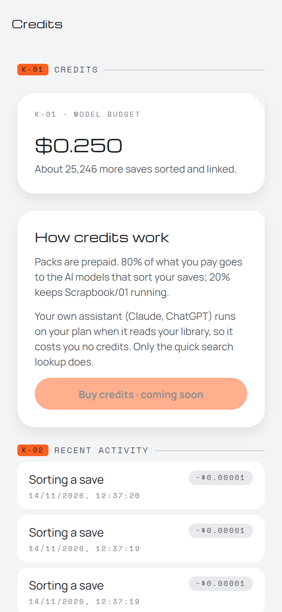
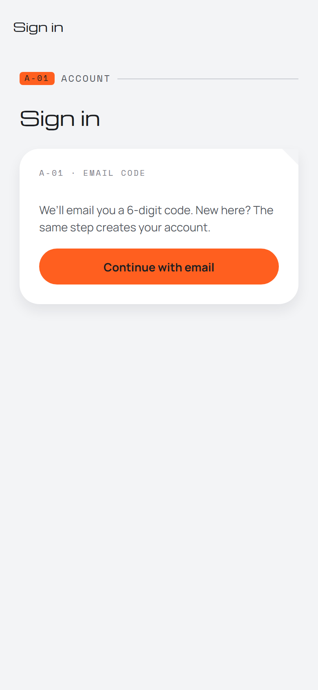

[← README](../README.md) · **Features** · [Getting started](getting-started.md) · [Sorting](sorting.md) · [AI assistants](ai-assistants.md) · [Self-hosting](self-hosting.md) · [Architecture](architecture.md) · [Development](development.md)

# Features

A tour of Scrapbook/01, from sharing a link to finding it again.

**On this page:** [Saving](#saving) · [The library](#the-library) · [An item](#an-item) ·
[The graph](#the-graph) · [Credits](#credits) · [Signing in](#signing-in) · [Notifications](#notifications)

## Saving

Share from any app and the Scrapbook/01 sheet opens with the link filled in.

- **iOS:** the sheet opens on top of the app you're in (a share extension). It's signed in because it
  shares the app's keychain.
- **Android:** sharing opens the app on the same sheet.
- **Anywhere:** "Add link" in the library takes a pasted link, and on the web it's the only way in.

The sheet asks one question: **"What is it about?"**. A few words are enough: "5 dad-daughter
traditions to try", "ramen bar in Shinjuku". That line is what sorting, the graph and search work
from. Scrapbook/01 never scrapes the post or guesses from its link, so it works the same for every
app, including private and login-only ones.

Describing is optional. Saves without a description go to the **Undescribed** inbox until you add
one. Links are cleaned up when saved: tracking parameters go, `twitter.com` becomes `x.com` and
`youtu.be` becomes `youtube.com/watch`, so sharing the same post twice updates one item instead of
making two.

 

## The library

Newest first, each save with its platform, its description and the category it was filed into. A save
shows "Sorting…" for the few seconds it takes, and "Waiting for credits" if you've run out.

The **Undescribed** tab is the inbox: saves you shared without a description. Tap one to add it.

 

## An item

Open a save to:

- open the original post;
- edit what it's about (sorting runs again when the text changes);
- **change its category**. A category you pick stays: automatic sorting never moves that item again,
  and the correction is kept to improve sorting later;
- see its **connections** (below);
- delete it.

 

## The graph

Every described save is turned into a vector once, and linked to its five closest saves. Those links,
plus each save's category, make a graph.

- **Each item** shows its connections one hop out, or two. Tap a neighbor and the screen becomes that
  item, while the graph keeps its layout, the way Obsidian's local graph does.
- **The Graph view** draws the whole library: category hubs in Module/01's category colors, saves
  around them, similar saves linked. Tap a node to focus it: its neighbors stay lit and the rest dims.

It's drawn with [react-force-graph](https://github.com/vasturiano/react-force-graph) in an Expo DOM
component, so the same canvas runs on the web and in a web view on phones. Big libraries are capped at
the newest 2,000 saves.

 

  

## Credits

Sorting uses paid AI models, so it runs on prepaid credits. The credits screen shows what's left,
roughly how many saves that covers, and what each one cost.

- New accounts start with a small free budget ($0.10 by default, thousands of saves).
- Packs split **80% to model costs and 20% to keeping the service running**.
- Out of credits, saves are still kept. They wait, marked "Waiting for credits", and sort within the
  hour after a top-up.
- Your own AI assistant costs you no credits: it runs on your plan. Only its search lookups (one small
  embedding each) are counted, and with no credits left search falls back to free keyword matching.

Buying packs isn't connected to a payment provider yet. A self-hosted instance grants credits from the
command line (see [self-hosting](self-hosting.md#credits)).

 

## Signing in

Sign-in is [WorkOS AuthKit](https://workos.com/docs/authkit): "Continue with email" opens its hosted
page, which emails a 6-digit code. The same step creates an account. There are no passwords, and no
mail server to run: WorkOS sends the codes.

The app never holds a secret. It uses the OAuth code flow with PKCE, keeps the session in the device's
keychain (shared with the iOS share extension), and refreshes it when the API needs a token.

 

## Notifications

After a save is sorted, the phone gets a notification: "Saved to *Japan trip*". Tapping it opens the
item, so a wrong category is one tap from being fixed. Notifications go through
[Expo Push](https://docs.expo.dev/push-notifications/overview/) and need a development or store build.

---

[← README](../README.md) · Next: [Getting started →](getting-started.md)
