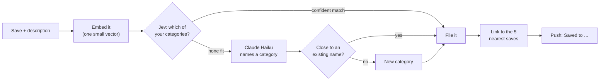

[← README](../README.md) · [Features](features.md) · [Getting started](getting-started.md) · **Sorting** · [AI assistants](ai-assistants.md) · [Self-hosting](self-hosting.md) · [Architecture](architecture.md) · [Development](development.md)

# How saves get sorted

What happens between tapping Save and "Saved to *Japan trip*", and why it costs so little.

**On this page:** [The pipeline](#the-pipeline) · [What it costs](#what-it-costs) ·
[Why not scrape the post?](#why-not-scrape-the-post) · [What never costs anything](#what-never-costs-anything) ·
[Tuning](#tuning)

## The pipeline

Saving returns at once. Sorting runs in the background (`server/internal/classify`), from the one line
you wrote:

1. **Embed.** The description becomes a 1536-number vector (`text-embedding-3-small` by default),
   stored in Postgres with pgvector. It's computed once per description.
2. **Pick a category.** [Jev](https://typesafe.ai) (TypeSafe's classifier) gets the description and
   your categories, each described by a few of the saves already in it, and answers with one of them
   or "None of these", plus a confidence. It has to reach `JEV_THRESHOLD` (0.6 by default) to count.
3. **Name a new one, only if needed.** When nothing fits, Claude Haiku (`claude-haiku-5-5`, low
   effort) names a category in one to three words, in the language the description is in. If the
   name's embedding is very close (0.85 or more) to an existing category's, that one is used instead,
   so "Recipes" doesn't spawn "Recipe ideas".
4. **Link.** The five nearest saves by cosine similarity, above `GRAPH_MIN_SIMILARITY`, become the
   item's links in the graph.
5. **Tell you.** A push notification says where it went. Tapping it opens the item, one tap from
   moving it.

Moving an item yourself is final: automatic sorting never touches that item again, and the correction
is stored (`category_feedback`) as a labeled example for tuning.

## What it costs

At list prices (configurable in `server/.env`; check your providers' current prices):

| Step | Model | Per save |
| --- | --- | --- |
| Embed the description | `text-embedding-3-small`, about $0.02 per million tokens | ≈ $0.0000005 |
| Pick a category | Jev, about $0.042 per million input tokens | ≈ $0.000013 |
| Name a new category (rare) | Claude Haiku | ≈ $0.0002 |
| Links, graph, notification | pgvector and Expo Push | $0 |

So a typical save costs **about $0.000014**, and one that starts a new category about **$0.0002**.
The starting $0.10 of credits covers thousands of saves.

Every call records its token usage on a meter (`server/internal/ai/usage.go`), and the job charges the
total to the user's credit ledger in micro-dollars when it finishes.

## Why not scrape the post?

Instagram, TikTok and X don't offer a sanctioned way to read a post's content, scraping them breaks
their terms and breaks often, and the link's preview text is usually generic ("Watch this reel"). You
know what you saved and why, in your own words, and a short human description sorts better than any
caption. It also keeps the AI input tiny, which is why sorting costs a fraction of a cent.

## What never costs anything

- Saving a link again without changing its description: nothing re-runs, since sorting only happens
  when the description text changes.
- An item whose category you picked yourself.
- Opening, browsing and the graph: they're plain database queries.
- Your own AI assistant's reasoning, which runs on your plan (see [AI assistants](ai-assistants.md)).

## Tuning

| Setting | Default | Effect |
| --- | --- | --- |
| `JEV_THRESHOLD` | `0.6` | Confidence Jev needs to file into an existing category. Higher makes more new categories |
| `GRAPH_MIN_SIMILARITY` | `0.45` | How alike two saves must be to link. Depends on the embeddings model |
| `CATEGORY_NAMER_ENABLED` | `true` | Turn off to never create categories automatically |
| `CATEGORY_NAMER_MODEL` | `claude-haiku-5-5` | The model that names categories |
| `JEV_PRICE_PER_MTOK`, `EMBEDDINGS_PRICE_PER_MTOK`, `NAMER_*_PRICE_PER_MTOK` | list prices | What each call is metered at |

Missed items (a failed call, or a user who was out of credits) are picked up by a sweep: every minute
locally, hourly on AWS.

---

[← Getting started](getting-started.md) · Next: [AI assistants →](ai-assistants.md)
